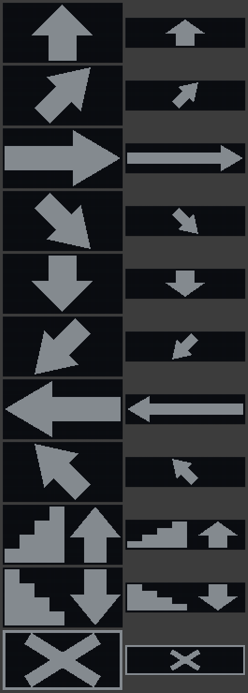

# oled_fw：HUB-8735 Ultra 多塊 OLED 方向顯示

一台 HUB-8735 Ultra 同時驅動多塊 SSD1306，每塊顯示一個路口的避難方向。本專題 9 塊**全部用 0.96 吋 128×64**；函式庫也保留 0.91 吋 128×32 的支援（可混用），但範例預設都是 0.96 吋。1.3 吋（SH1106 控制器）**不支援**，本專題也不用。介面直接吃伺服器的 `{id, dir}` 回應。

> 狀態（2026-11-10）：arduino-cli 編譯通過（3 種接法 × MultiOledDemo、5 台 HUB 與第 5 台的 Wire1 備案 × Hub1FCeiling）。**還沒上板子實測**，接腳、0x3D、TCA9548A 都只照 SDK 原始碼和規格推定。

```
oled_fw/
├── libraries/EvacOled/          Arduino 函式庫（不依賴 Adafruit GFX）
│   ├── src/EvacOled.h/.cpp      驅動、方向換算、JSON 解析
│   ├── src/EvacIconData.h       圖示點陣（自動產生，勿手改）
│   └── examples/
│       ├── MultiOledDemo/       三種接法輪播＋序列埠指令
│       └── Hub1FCeiling/        1F 九塊（4 台角落 HUB＋第 5 台 OLED 專用 HUB）
├── tools/gen_icons.py           產生 EvacIconData.h 與 PNG 預覽
├── tools/compile_all.sh         一次編譯全部組合
└── preview/                     圖示預覽（contact_sheet.png 是總覽）
```

## 接線

模組（0.96 吋 SSD1306）已焊好 4 pin 直排針，順序是 **GND、VCC、SCL、SDA**：

| 模組排針 | 接到 HUB-8735 Ultra |
|---|---|
| GND | GND |
| VCC | 3.3V |
| SCL | `Wire`：Pin 4；`Wire1`：Pin 1 |
| SDA | `Wire`：Pin 3；`Wire1`：Pin 0 |

注意排針順序是 SCL 在 SDA 前面，和 HUB 腳位「SDA 編號比較小」相反，接杜邦線時別接反。

| 匯流排 | SDA | SCL | 來源 |
|---|---|---|---|
| `Wire` | **Pin 3**（PE4） | **Pin 4**（PE3） | SDK `variants/ameba_hub8735_ultra/variant.h` 第 124–125 行 `I2C_SDA/I2C_SCL`；與舊測試 `oled_hello_wire34` 相同 |
| `Wire1` | **Pin 0**（PF2） | **Pin 1**（PF1） | 同檔第 126–127 行 `I2C1_SDA/I2C1_SCL`；`libraries/Wire/src/Wire.cpp` 第 321–322 行（`HUB8735_ULTRA` 分支）把 `Wire1` 綁在這兩腳；SDK 範例 `OLED_SSD1306/hub8735ultra_board.h` 的腳位圖也標 `Wire1 I2C1_SDA(PF2) 0 / I2C1_SCL(PF1) 1` |

- 同一組匯流排上的兩塊模組，四條線都並聯即可（GND–GND、VCC–VCC、SCL–SCL、SDA–SDA）。
- Pin 0/1 目前 `hub_node` 韌體沒用到（它的 LED 腳是 11,12,13,24,23,18,22,21,20,19），Pin 3/4 也沒用到。
- 模組板上通常已有上拉電阻；一條匯流排掛 2 塊沒問題。經天花板溝槽拉長線時若不穩，把 `begin()` 的時脈改成 `100000`。

### 三種接法與上限

| 設定 | 接法 | 最多幾塊 | 備註 |
|---|---|---|---|
| `EVAC_WIRING=1` | Wire 上 0x3C、0x3D | **2** | SSD1306 只有兩個位址；第二塊要改焊成 0x3D（見下節） |
| `EVAC_WIRING=2` | Wire（0x3C/0x3D）＋ Wire1（0x3C/0x3D） | **4** | 每組匯流排各 2 塊 |
| `EVAC_WIRING=3` | Wire 上接 TCA9548A（0x70），通道 0–7 各一塊 | **8** | 每通道都用 0x3C 就好，不必改位址。理論上每通道再加一塊 0x3D 可到 16，函式庫上限 `kMaxSlots = 16` |

函式庫本身不綁接法：每塊 OLED 一筆 `SlotConfig`，三種接法可以混在同一台板子上（例如 Wire 直接接 2 塊＋Wire1 上的多工器）。不在多工器後面、但和多工器同一條匯流排的螢幕，函式庫會先把多工器所有通道關掉再跟它講話，避免同位址相撞。

### 改焊成 0x3D

模組出廠是 0x3C。背面有一組標著 **IIC ADDRESS SELECT** 的電阻位置，兩側分別標 **0x78** 和 **0x7A**。這是 8 位元的寫入位址：0x78 = 0x3C、0x7A = 0x3D。出廠時電阻焊在 0x78 那一側。

步驟：

1. 先在模組正面貼上路口代號（例如「NW」），以免改完後混在一起。
2. 烙鐵溫度約 300–330 °C。兩端同時加熱（可以先在兩端各補一點錫，或用烙鐵頭橫跨兩端），電阻鬆開後用鑷子夾走。
3. 把同一顆電阻焊到 **0x7A** 那一側的兩個焊盤上。電阻弄丟的話，0 Ω 或直接用錫橋接 0x7A 的兩個焊盤也可以，效果相同。
4. 檢查 **0x78 那一側已經完全斷開**、沒有殘錫連著。兩側都通的話，位址不會是 0x3D。
5. 接上 HUB，燒 `MultiOledDemo`（`EVAC_WIRING=1`），開序列埠輸入 `scan`，應該會看到 `Wire: 0x3D`。只接這一塊時，若掃到 0x3C 就表示沒改成功。

**要改焊的模組（4 塊角落）**：

| HUB | 改焊成 0x3D |
|---|---|
| HUB_N | **NW** |
| HUB_E | **NE** |
| HUB_S | **SE** |
| HUB_W | **SW** |

其餘 5 塊（C、N、E、S、W）接在第 5 台 TCA9548A 的各通道，維持出廠 0x3C，不用動。

（角落 HUB 現在各只接一塊，嚴格說不改焊、用 0x3C 也行：編譯時加 `-DEVAC_CORNER_ADDR=0x3C`。照目前規劃仍用 0x3D。）

### 更新速度（SDK 限制）

SDK 的 `TwoWire::endTransmission()` 每次都會重新初始化 I2C，並固定等待「位元組數 × 200 µs」（`Wire.cpp` 第 189 行），所以時脈設多高都沒用：

- 整塊 128×64 重畫約 0.21 秒（128×32 約 0.1 秒）。
- 函式庫只送「和上一張圖不同的頁」，換方向通常只重送部分頁面。
- 閃爍只送一個開／關顯示指令（0xAF/0xAE），不重送畫面。
- 多工器 8 塊同時換方向最差約 1.7 秒。`update()` 重畫時會卡住 loop，接進 `hub_node` 時要考慮它每 ~200 ms 一次的 POST。

## 圖示



左欄 128×64（本專題用這個）、右欄 128×32（保留的支援）；`preview/contact_sheet_1x.png` 是 1:1 大小，看遠距離的感覺。個別圖檔在 `preview/<圖示>_128x64.png`、`_128x32.png`。

| 伺服器 `dir` | 顯示 |
|---|---|
| `N` `NE` `E` `SE` `S` `SW` `W` `NW` | 大箭頭（依安裝方向換算成螢幕方向，見下節） |
| `UP` / `DOWN` | 樓梯剖面＋上／下箭頭（不隨安裝方向旋轉） |
| `X` | 外框＋粗 X，禁止通行 |
| `OFF` 或 `""` | 全黑 |

任何方向加上 `"blink":true`（或 `"mode":"blink"`）就以 1 Hz 閃爍（`setBlinkPeriod()` 可調）。

正方向的箭頭沿長邊撐滿螢幕（128×64 的左右箭頭 124×60）；斜向保持真正的 45°，所以會小一些。若日後改用 0.91 吋，它只有 32 px 高，上下和斜向箭頭先天就小。

改圖示：編輯 `tools/gen_icons.py` 後執行

```bash
python -I oled_fw/tools/gen_icons.py
```

它會重寫 `EvacIconData.h`，再把標頭**解析回來**畫預覽，所以預覽就是燒進板子的資料。不需要 Pillow。

## 方向換算（裝在天花板要注意）

伺服器送的是絕對方位。每塊螢幕的 `SlotConfig` 寫兩件事：

- `top`：螢幕上緣朝哪個方位。
- `ceiling`：`true` 表示螢幕朝下裝在天花板。從下往上看是鏡像，同一張圖左右相反。

換算（`EvacOled.cpp` 的 `iconFor()`）：方位 k（N=0，順時針每格 45°）→ 螢幕方向 s（螢幕上方 = 0，順時針）：

- 一般安裝：`s = k − top`
- 朝下裝天花板：`s = top − k`

這樣箭頭尖端在天花板上**實際指向**目標方位，不管觀眾站在哪裡看都對。下圖兩欄都是「上緣朝北」，每列依序是 N、E、S、W：左欄是一般安裝，右欄是天花板。天花板上的 E 在螢幕上畫成「往左」：


模型還沒實裝，範例先假設 `top = N`、`ceiling = true`。裝好後每塊送一次 `{"id":"<路口>","dir":"N"}`，看箭頭是否指向北；不對就改 `top`。

## 程式介面

```cpp
#include <EvacOled.h>
using namespace evac;

const SlotConfig kSlots[] = {
  // id    bus          addr  mux     panel            top         ceiling
  {"N",  Bus::Wire0, 0x3C, kNoMux, Panel::P128x64, Compass::N, true},
  {"NW", Bus::Wire0, 0x3D, kNoMux, Panel::P128x64, Compass::N, true},
};
EvacOled oled;

void setup() { oled.begin(kSlots, 2); }           // 可加 MuxConfig*、I2C 時脈
void loop()  { oled.update(); }                     // 重畫、閃爍、每 2 秒重試沒接上的螢幕

// 收到伺服器回應時：
oled.applyJson(body);   // 新格式：任何含 "id"、"dir" 的物件，例
                        // {"oled":[{"id":"N","dir":"W"},{"id":"NW","dir":"X","blink":true}]}
oled.applyLeds(body);   // 現有 hub_node 格式 {"leds":["E","S"],"blink":0}：依序套到第 0、1… 塊
oled.set("N", Sign::Up, /*blink=*/true);
```

- 回應裡沒提到的路口保持原狀（斷線時保留最後方向）。
- `scan(Serial)` 會列出每組匯流排（和多工器每個通道）看得到的位址，接線除錯用。
- 函式庫只用 flash 裡的點陣直接串流，不佔 RAM 畫面緩衝。

## 1F 九塊的分配（5 台 HUB）

```
NW ── N ── NE     HUB_N、HUB_E、HUB_S、HUB_W（跑鏡頭＋模型）：
│     │     │       各自 Wire 0x3D 接一個角落：N→NW、E→NE、S→SE、W→SW
W ─── C ─── E     HUB_OLED（第 5 台，只驅動 OLED）：
│     │     │       Wire 上的 TCA9548A（0x70），通道 0..4 = C、N、E、S、W，全部 0x3C
SW ── S ── SE
```

全部 0.96 吋 128×64。第 5 台怎麼從伺服器拿到這 5 個路口的方向屬於 `hub_node` 的範圍，這裡只做 OLED 驅動（`applyJson()` 收 `{"id":"C","dir":"E"}` 這種格式就能直接用）。

### 編譯時選擇（`examples/Hub1FCeiling`）

| 巨集 | 值 | 意思 |
|---|---|---|
| `EVAC_HUB` | 0/1/2/3 | 角落 HUB N/E/S/W，只驅動 1 塊角落 |
| `EVAC_HUB` | 4 | 第 5 台 HUB_OLED |
| `EVAC_CORNER_ADDR` | 預設 `0x3D` | 角落螢幕位址。每台角落 HUB 只有一塊，其實用出廠 0x3C 也行（就不必改焊） |
| `EVAC_HUB5_BUS` | 2（預設）= TCA9548A、1 = Wire＋Wire1 備案 | 第 5 台的接法 |
| `EVAC_WIRE1_COUNT` | 1 或 2（預設 2） | 備案時 Wire1 上接幾塊 |

對應表每一格本來就有 `bus` 和 `muxChannel` 欄位（`SlotConfig`），原本只接 Wire 的寫法（`Bus::Wire0`、`kNoMux`）不用改；接在多工器後面就把 `muxChannel` 填 0..7，並在 `begin()` 傳 `MuxConfig{Bus::Wire0, 0x70}`：

```cpp
{"C", Bus::Wire0, 0x3C, 0, Panel::P128x64, Compass::N, true},   // TCA9548A 通道 0
{"N", Bus::Wire0, 0x3C, 1, Panel::P128x64, Compass::N, true},   // 通道 1 …
```

函式庫每次寫入前會先把 TCA9548A 切到該塊的通道（同一通道連續寫入時不重切）。TCA9548A 沒回應時，直接接在 Wire 上的螢幕照常運作，多工器後面的螢幕離線並每 2 秒重試。

### 第 5 台接線（TCA9548A，主要做法）

```
 HUB-8735 Ultra（第 5 台）        TCA9548A 模組
 ┌──────────┐                    ┌───────────────────────┐
 │ 3.3V     ├────────────────────┤ VIN                   │
 │ GND      ├────────────────────┤ GND                   │
 │ Pin 4    ├──── SCL ───────────┤ SCL                   │
 │ Pin 3    ├──── SDA ───────────┤ SDA                   │
 └──────────┘          GND ──────┤ A0  A1  A2  → 0x70    │
                                 │ RST（模組已上拉，空著）│
                                 │ SD0/SC0 ──────────────┼── C  中心
                                 │ SD1/SC1 ──────────────┼── N  北邊中點
                                 │ SD2/SC2 ──────────────┼── E  東邊中點
                                 │ SD3/SC3 ──────────────┼── S  南邊中點
                                 │ SD4/SC4 ──────────────┼── W  西邊中點
                                 │ SD5..7/SC5..7  空著    │
                                 └───────────────────────┘
```

| TCA9548A | 接到 |
|---|---|
| VIN | HUB 3.3V |
| GND | HUB GND |
| SDA | HUB Pin 3（Wire SDA） |
| SCL | HUB Pin 4（Wire SCL） |
| A0、A1、A2 | GND（位址 0x70） |
| SDn / SCn（n = 0..4） | 該通道 OLED 的 SDA / SCL；OLED 的 VCC、GND 接 HUB 3.3V、GND |

| 通道 | OLED | 位址 |
|---|---|---|
| 0 | C 中心 | 0x3C |
| 1 | N 北邊中點 | 0x3C |
| 2 | E 東邊中點 | 0x3C |
| 3 | S 南邊中點 | 0x3C |
| 4 | W 西邊中點 | 0x3C |

- 5 塊全部出廠 0x3C，不用改焊；每個通道是獨立的匯流排，同位址不會相撞。
- 每個 OLED 模組自帶上拉電阻，通道之間互不影響。
- 速度：5 塊同時換方向最差約 1 秒（每塊整頁 0.21 秒，見「更新速度」）；只換其中幾塊時更快。
- 序列埠輸入 `scan` 會逐通道列出看到的位址：`Wire:` 那行應有 `0x70`，`mux ch0..4` 各應有 `0x3C`。

### 第 5 台的備案：Wire＋Wire1（不夠 5 塊）

每條匯流排只有 0x3C、0x3D 兩個位址，Wire 2 塊＋Wire1 2 塊 = **最多 4 塊，不夠 5 塊**。`EVAC_HUB5_BUS=1` 時排成 C、N 在 Wire（0x3C、0x3D），E、S 在 Wire1（0x3C、0x3D），**W 沒有螢幕**，而且 N、S 要改焊成 0x3D。只在 TCA9548A 臨時缺貨、或要先用 Wire1 測試時使用。

SDK 4.0.15 裡 `Wire1` 的實際定義：

- `libraries/Wire/src/Wire.cpp` 第 320–322 行：
  ```cpp
  #ifdef HUB8735_ULTRA
  TwoWire Wire  = TwoWire((void *)(&i2cwire0), I2C_SDA, I2C_SCL);
  TwoWire Wire1  = TwoWire((void *)(&i2cwire1), I2C1_SDA, I2C1_SCL);
  ```
- `variants/ameba_hub8735_ultra/variant.h` 第 44 行 `#define HUB8735_ULTRA`；第 126–127 行 `I2C1_SDA = AMB_D0 // PF_2`、`I2C1_SCL = AMB_D1 // PF_1`。
- 所以 **Wire1：SDA = Pin 0（PF2）、SCL = Pin 1（PF1）**。

**和光感測器衝突**：同一檔第 89–90 行 `A1 = AMB_D1 (PF_1)`、`A2 = AMB_D0 (PF_2)`。課程的光感測器 AO 接在 Pin 0、程式讀 `A2`（見 `oled_light_sensor_wire34`、`015_MQTT_Basic_測試`）。用了 Wire1，Pin 0 就不能再讀光感測器，Pin 1 也不能當類比輸入；光感測器要改接別的類比腳（例如 `A0` = Pin 2 / PF0）。

```
 HUB-8735 Ultra                0.96" OLED（排針 GND、VCC、SCL、SDA）
 ┌──────────┐
 │ GND      ├──── GND ─┐
 │ 3.3V     ├──── VCC ─┤（所有模組並聯）
 │ Pin 1    ├──── SCL ─┬── E (0x3C) ── S (0x3D)     Wire1
 │ Pin 0    ├──── SDA ─┘
 │ Pin 4    ├──── SCL ─┬── C (0x3C) ── N (0x3D)     Wire
 │ Pin 3    ├──── SDA ─┘
 └──────────┘
```

### 桌上實測 Wire1（約 10 分鐘）

只測 Wire1 能不能點亮一塊 OLED：

1. 拿一塊出廠 0x3C 的 0.96 吋模組，只接 Wire1：GND→GND、VCC→3.3V、SCL→**Pin 1**、SDA→**Pin 0**。光感測器先拔掉。
2. 燒錄 `Hub1FCeiling`，設定 `EVAC_HUB=4`、`EVAC_HUB5_BUS=1`（用 IDE 的話改檔案開頭這兩個 `#define`）。
3. 開序列埠 115200，應看到 `HUB_OLED (Wire+Wire1 backup) OLED online 1/4`（只有 Wire1 的 E 在線）。
4. 輸入 `scan`，`Wire1:` 那行應該有 `0x3C`。
5. 輸入一行 `{"id":"E","dir":"E"}`，回 `applied 1`，OLED 出現箭頭。再試 `{"id":"E","dir":"X","blink":true}`，應該是閃爍的 X。
6. 不亮時：檢查 SCL/SDA 是否接反（排針順序是 SCL 在前）、VCC 是否接 3.3V。

TCA9548A 到貨後用同樣方法測主要做法：`EVAC_HUB=4`、`EVAC_HUB5_BUS=2`。

## 編譯

```powershell
& '..\..\tools\arduino-cli\arduino-cli.exe' compile --config-file <你的 arduino-cli.yaml> `
  --fqbn ideasHatch:AmebaPro2:Ameba_HUB-8735_ultra `
  --library oled_fw\libraries\EvacOled `
  --build-property "build.extra_flags=-DARDUINO_SDK -DARDUINO_AMBPRO2 -DBOARD_AMB82_HUB8735 -DBOARD_AMB82_HUB8735_ULTRA {build.usb_flags} {build.menu_flags} -DEVAC_WIRING=2" `
  oled_fw\libraries\EvacOled\examples\MultiOledDemo
```

覆寫 `build.extra_flags` 時一定要保留板子原本的旗標（`boards.txt` 第 108 行），只加 `-DEVAC_WIRING=2` 會在 `Arduino.h` 報「Please choose between Flash or SD card」。也可以不加旗標，直接改範例開頭的 `#define`。

yaml 需設 `directories.data: %LOCALAPPDATA%\Arduino15`（SDK 4.0.15 裝在那裡）。全部組合：

```bash
bash oled_fw/tools/compile_all.sh <arduino-cli.exe> <arduino-cli.yaml> <輸出目錄>
```

## 待實測

- 0x3D 模組、Wire1（Pin 0/1）、TCA9548A 在實板上是否都正常（Wire1 照「桌上實測 Wire1」）。
- 第 5 台 TCA9548A 的 5 個通道（照「第 5 台接線」）。
- 天花板上每塊螢幕的 `top` 方向（裝好後逐塊確認）。
- 從模型外 1:40 人偶視角看，箭頭大小與閃爍頻率是否合適。
