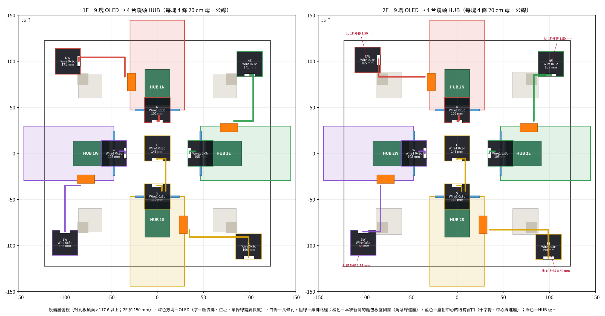
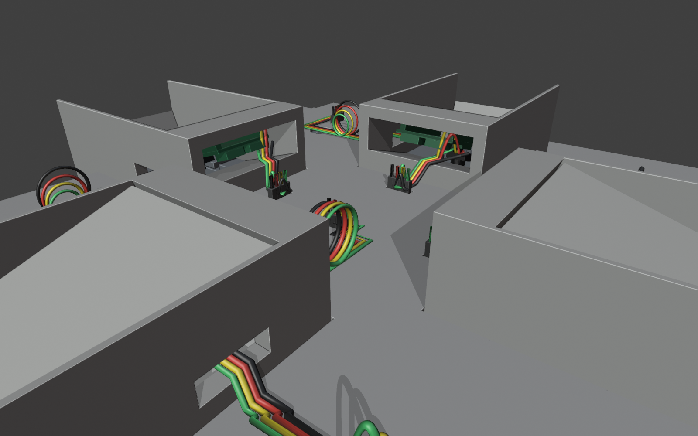
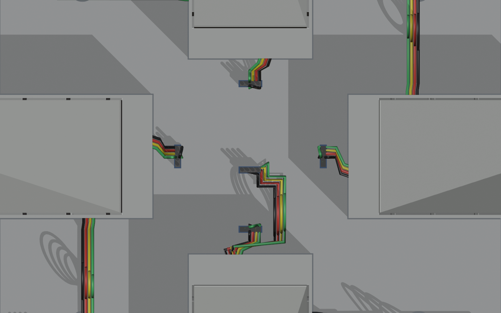
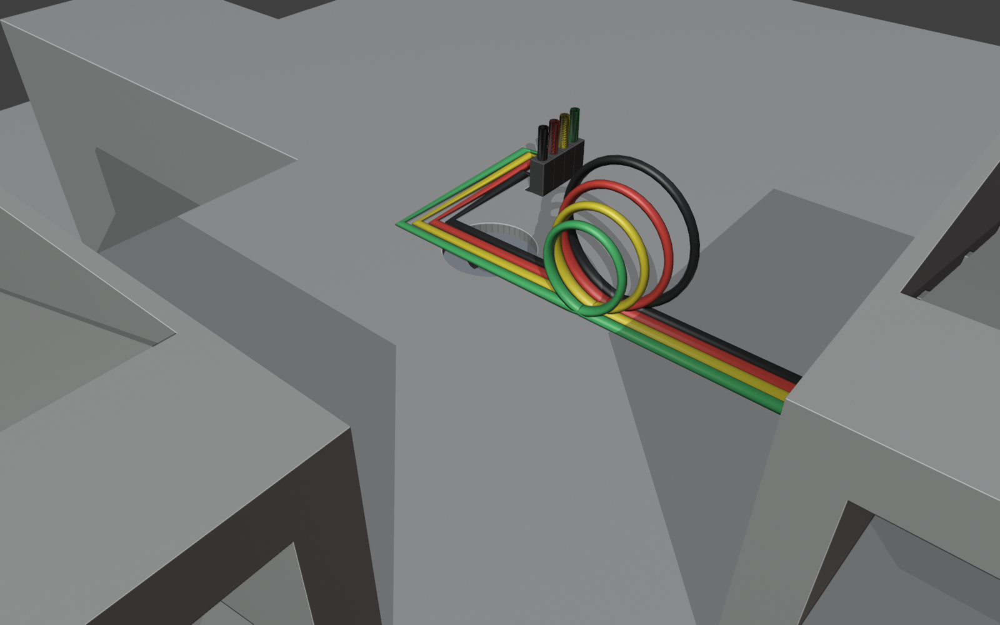
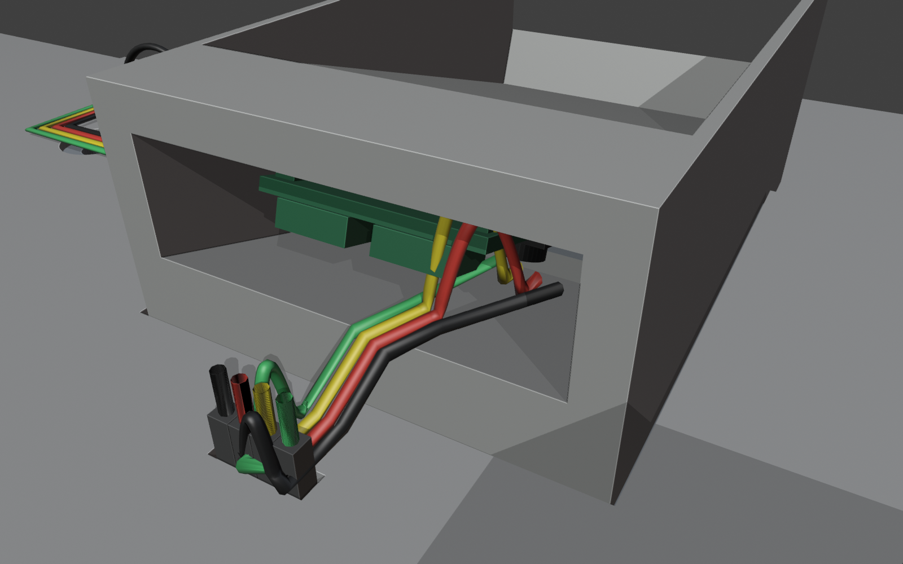
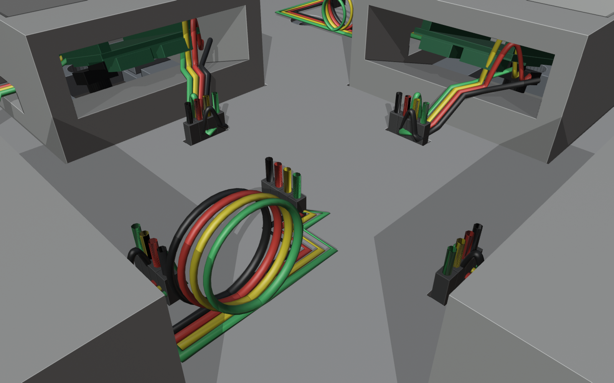

# 8 台鏡頭 HUB 驅動 18 塊天花板 OLED（2026-11-18，取代方案 D）

**改了什麼**：取消 3 台只驅動 OLED 的 HUB（H5／H6／H7）。1F、2F 各 9 塊 OLED 全部由原本的 8 台鏡頭 HUB 直接驅動，每台 2～3 塊。
每塊 OLED 用 4 條母－公杜邦線，共 18 × 4 = **72 條：10 cm × 32 條（十字臂中點 8 塊）＋20 cm × 40 條（角落 8 塊＋中心 2 塊）**，不用分接板、不用多工器。

## 0. 在 Blender 裡的成品

`blender_build_wiring.py` 在已開啟的 `fire_model.blend`（11/04 另存的那份，和 `physical_model/` 相同）上分三步執行：
1. **切孔**：麵包板座側窗、天花板與封孔板的長條孔。
2. **放 OLED**：18 塊，用 GitHub `model_oled_ceiling/fire_model_oled_through_hole.blend` 的穿孔版 0.96 吋模組（玻璃、顯示區、PCB、背面零件、雙面膠、排針、排針塑膠座、杜邦母座）。
3. **拉 72 條實體杜邦線**：每條一個 curve，黑 GND、紅 VCC、黃 SCL、綠 SDA，線排順序和排針一致不交叉。**每塊 OLED 的 4 條依走線距離選 10 cm 或 20 cm**（母頭 14＋線身 66／166＋公頭 20 mm）：十字臂中點離自己的 HUB 只要 47～60 mm，用 10 cm；角落、中心要 99～162 mm，用 20 cm。走線用不到的長度（3.8～66.7 mm）同一束一起收：少的壓成線排上的低拱，多的在線排正上方繞成直立線圈。模型裡的長度就是實際買的線。

2026-11-18 已在使用者電腦的 Blender 5.2 上實際執行，存成 `fire_model_8hub_wiring.blend`：切孔零件非流形邊 0；72 條線長度正好 100.0 mm（32 條）或 200.0 mm（40 條）、沒有一條不夠長、沒有壓到塞子。逐條數據在 `blender_build_report.json`、`接線表_72條.md`。

## 1. 分配

| HUB | 角落（Wire 0x3C，Pin3 SDA／Pin4 SCL） | 十字臂中點（Wire1 0x3C，Pin0 SDA／Pin1 SCL） | 中心（Wire1 **0x3D**） |
|---|---|---|---|
| 1N／2N | 西北 J(-1,1) | 北 J(0,1) | — |
| 1E／2E | 東北 J(1,1) | 東 J(1,0) | — |
| 1S／2S | 東南 J(1,-1) | 南 J(0,-1) | 中心 J(0,0) |
| 1W／2W | 西南 J(-1,-1) | 西 J(-1,0) | — |

- 2F 的路口代號是 `J2(i,j)`。伺服器回給每台板子的是「自己那層」的 9 個路口，板子依 `hub_node.ino` 的 `OLED_MAP` 挑出自己的 2～3 個。
- **要改焊成 0x3D 的只有兩層的中心各 1 塊，共 2 塊**（方案 D 要改 N、E 兩塊；這版每台的角落和十字臂分在不同匯流排，都用出廠 0x3C）。
- 同一台 HUB 上同一條匯流排最多 2 塊（只有 S 座的 Wire1：南臂 0x3C＋中心 0x3D）。

## 2. 實體模型的修改（`fire_model_8hub_wiring.blend`）

以 `physical_model/fire_model.blend` 的複本執行 `build_8hub_wiring.py`，原檔不動。

1. **麵包板座開側窗**（8 座，同一個零件轉 90°）
   - 座內的麵包板是倒掛的：HUB 插在麵包板下面，鏡頭朝下。HUB 與天花板之間、排針外側有一層空間，側窗就開在這層。
   - 位置以 N 座為準：西牆、離中心 y 68～87、z 122～129（2F 加 150），從外牆面往內切 6 mm（下段牆厚 5 mm）。
   - E 座在北牆、S 座在東牆、W 座在南牆，各自面向自己負責的角落。
   - 檢查：8 個窗開孔後非流形邊 0；從窗口往座內看，第一個碰到的是 16 mm 外的 HUB 排針，27/27 取樣點淨空都 ≥ 10 mm。
   - 已經印好的座可以直接用美工刀或小鑽頭在側牆開 19 × 7 mm 的窗；要重印就用 `麵包板座_側窗_N方向.stl`（N 座方向，其他座轉 90°）。
2. **天花板長條孔**：OLED 位置、長條孔、畫面方向沿用 `model_oled_ceiling/`（穿孔＋雙面膠，9 塊）。
   - 1F 用既有的 `1F_天花板_穿孔.stl`、`1F_天花板封孔板_穿孔.stl`。本腳本重切一次的體積和 repo 的 STL 完全相同（317,711.3／148,392.6 mm³），可以當作沒有走樣的證明。
   - 2F 的天花板、封孔板、麵包板座、鏡頭和 1F 逐點相同（只高 150 mm），**但 2F 四角的房間塊比較大**（延伸到 ±88 mm，1F 是 ±85.5）。照 1F 的位置，角落模組會壓到 2F 的牆。
   - 所以 2F 四個角落往外移最小距離（`search_2f_corners.py`）：西北 +y 1.5、東北 +x 1.5、東南 −y 0.5、西南 −x 1.75 mm。2F 要印 **`2F_天花板_穿孔.stl`、`2F_天花板封孔板_穿孔.stl`**，不能直接用 1F 的。
3. 模型裡的 OLED 模組、母座、線排都在 `OLED_8HUB接線` collection，線排顏色＝負責的 HUB。

## 3. 檢查結果（`wiring_8hub.json`）

| 項目 | 結果 |
|---|---|
| 72 條線 | 10 cm × 32＋20 cm × 40 建模，走線需要 47～162 mm，多餘 3.8～66.7 mm 收成低拱或線圈；最緊的是 2F 東南角（20 cm，多餘 3.8 mm）。第 3 節以下的「需要長度」是早先的保守估算（座內段用最遠排針） |
| 模組下方有沒有高到天花板的牆（模組外擴 0.6 mm） | 2F 全部 0。1F 西南角有 2/225 個邊界取樣點碰到，是隊友原本的位置，實際間隙約 0.35～0.6 mm，量實物時注意 |
| 長條孔外擴 0.8 mm 是否從 z 108.2 到 117.6 連續實心 | 18 個孔全部通過 |
| 鏡頭可見像素（同層 4 台、576×320、等立體角魚眼） | 18 塊 × 4 台全部 0 像素 |
| 線排壓到塞子頂面 | 角落、中心 0 mm；4 個十字臂各 2 mm（長孔本來就開在十字臂塞子上，和方案 D 相同） |

注意：2F 角落 2F 樓層盒裡有高 6～42 mm 的低矮構件，離 OLED 還有 60 mm 以上，不影響。

## 4. 麵包板端怎麼接

- 每台 HUB 先用 **2 條短跳線**把 HUB 的 3V3 接到紅色電源軌、GND 接到藍色電源軌（不算在 72 條裡）。所有 OLED 的 VCC、GND 公頭直接插電源軌。
- SDA／SCL 的公頭插在 HUB 該腳位同一列的空孔。
- **S 座**的 Wire1 要接 2 塊（南臂＋中心）。Pin0、Pin1 那一列如果只剩 1 個空孔，就各用 1 條短跳線把 Pin0、Pin1 引到 HUB 外側一列空的麵包板列，2 塊 OLED 的 SDA、SCL 再插那一列。
- 模型裡的 HUB 排針是示意排列。**接之前以板上絲印為準**，並確認 HUB 插上麵包板後每個腳位那一列還有空孔。

## 5. 材料（和方案 D 比）

| 項目 | 方案 D | 這版 |
|---|---|---|
| HUB-8735 Ultra | 4（1F 鏡頭）＋3（H5～H7） | **8（兩層鏡頭），不加** |
| 杜邦線 | 10／20／30／40 cm 混用 44 條（只有 1F） | **母－公 72 條（兩層）：10 cm × 32＋20 cm × 40**＋電源軌短跳線約 20 條 |
| 分接板、銅柱、USB 轉杜邦 | 要 | 不用 |
| 改焊 0x3D | 2 塊（N、E） | 2 塊（兩層中心） |

## 6. 還沒驗證（上板前要做）

1. **Wire1 實測**：照 `oled_fw/README.md`「桌上實測 Wire1」接一塊 OLED 到 Pin0／Pin1。Pin0／Pin1 和鏡頭、Wi-Fi 有沒有衝突也一起確認（鏡頭 HUB 跑模型時接 OLED）。
2. **完整 SDK 編譯** `hub_node`（這次只在電腦上用函式庫的型別編過 OLED 設定表；完整 arduino-cli 編譯要在有 SDK 的電腦上跑）。
3. 量實物：HUB 排針位置、麵包板空孔、側窗切開後牆的強度。
4. 每塊 OLED 的畫面上緣方向（`OLED_MAP` 的 top）是照模型的排針方向填的，裝好後看箭頭是否正確。

## 7. 檔案

| 檔案 | 內容 |
|---|---|
| `build_8hub_wiring.py` | 開側窗、檢查、繞線、算長度、切長條孔、出 .blend／STL／JSON（`python build_8hub_wiring.py <fire_model.blend 複本> <輸出>`，用 pip 的 `bpy==5.2.4`） |
| `search_2f_corners.py` | 2F 角落最小移位搜尋 |
| `plot_wiring.py` | 平面接線圖 |
| `接線表_72條.md` | 72 條線逐條：OLED 腳 → HUB 端、顏色、需要長度、餘裕 |
| `wiring_8hub.json` | 全部檢查數據、路徑座標 |
| `fire_model_8hub_wiring.blend` | 修改後的模型（側窗、兩層長條孔、OLED 示意、線排） |
| `2F_天花板_穿孔.stl`、`2F_天花板封孔板_穿孔.stl` | 2F 列印件 |
| `麵包板座_側窗_N方向.stl` | 開側窗的麵包板座（N 方向） |
